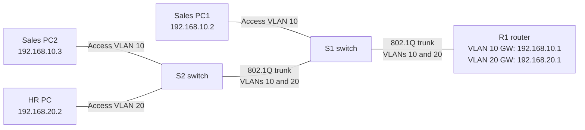

# Lab 01 — Connect Sales and HR without combining their networks

**In one sentence:** I set up two separate department networks and used one router connection to let their computers communicate.

## Topology at a glance

**How to read it:** Each line is a cable. A VLAN is a logical group of devices; the shared switch-to-router links carry traffic for both groups.

## What I changed

- Created two virtual networks (VLAN 10 for Sales and VLAN 20 for HR).
- Configured the switch connections to carry both VLANs and the router to act as each department's gateway.
- Checked the wiring, router interfaces, VLANs, and PC-to-PC communication.

## What I verified

- Each tested computer reached its gateway, and cross-department pings returned **4 out of 4 replies (0% packet loss)**.
- The routing table and switch status outputs matched the physical setup.

## What went wrong — and how I handled it

No unexpected failure occurred in this lab. I verified the wiring, VLAN assignments, routes, and connectivity rather than assuming it worked.

## Why it matters

Separate VLANs organize network traffic; routing lets those networks communicate when needed.

## Open the files

- [Technical write-up: configuration, commands, and evidence](./README.md)
- [Open the Packet Tracer project](./Lab%2001%20Router%20on%20a%20Stick%20Inter%20VLAN%20Routing.pkt)

**Note:** This is a simulated learning project, not a production deployment.
