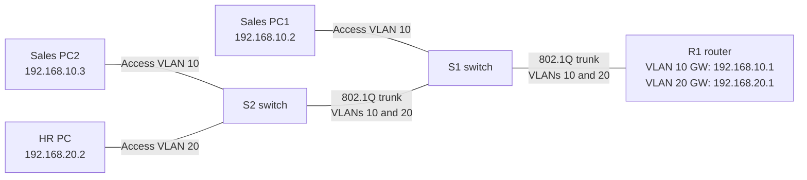

# Lab 01 in Plain Language — Two Departments, One Connection

## Topology at a glance



**How I'd explain this network (about 20 seconds):** I separated Sales and HR into two VLANs and connected them through one router interface using VLAN tags. Each department has its own gateway, and I verified that PCs in different VLANs could communicate through the router.

**Reading the diagram:** Solid lines represent physical connections. The two switch-to-switch and switch-to-router links carry both VLANs; a PC's access port belongs to only one VLAN.

**The task.** An office has two departments, Sales and HR. Their computers
must be kept on separate networks, but people still need to reach across when
work requires it. I built that setup with one router and one cable between
the router and the switches — a design nicknamed "router-on-a-stick,"
because a single router port carries both departments' traffic, with each
department's traffic tagged so it never mixes.

**The setup.** One Cisco router, two Cisco switches, three PCs — two in Sales
(network 192.168.10.0), one in HR (network 192.168.20.0) — built in Cisco
Packet Tracer.

**What I did.** Split the router's single connection into two tagged lanes,
one per department, and made the router each department's gateway — the
traffic cop that passes packets between the two networks. Then I assigned
each switch port to the right department and set the links between devices
to carry both departments' tagged traffic.

**The result.** Every test passed. Each PC reached its gateway, and PCs in
different departments reached each other — 4 out of 4 replies on every test,
zero lost. I also confirmed the result three other ways: the router's routing
table listed both networks, the switches reported both departments active,
and a neighbor-discovery check confirmed the devices were cabled exactly as
the diagram shows.

**What broke.** Nothing — honestly. This build worked on the first pass, so
there is no fix-it story to tell. The skill this lab actually demonstrates is
the verification: I didn't declare it working because the pings passed; I
proved the wiring, the department assignments, and the routing all agreed.

**What it proves.**

- I can segment a network into isolated groups and connect them through a
  router under control — the standard layout in most small offices.
- I work fluently at the Cisco command line, not just in diagrams.
- I verify in layers (cabling, assignments, routing, end-to-end tests) before
  calling something done.

**A sample of the configuration** (from the router; the full write-up with
every device's configuration is in this folder's README.md):

```
interface GigabitEthernet0/0/0.10
 encapsulation dot1Q 10
 ip address 192.168.10.1 255.255.255.0
!
interface GigabitEthernet0/0/0.20
 encapsulation dot1Q 20
 ip address 192.168.20.1 255.255.255.0
```

Each block is one department's lane on the shared cable: a tag (10 for Sales,
20 for HR) and the gateway address that department's computers use.
