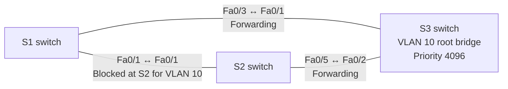

# Lab 02 — Add backup switch links without network loops

**In one sentence:** I connected three switches with redundant links and verified that Spanning Tree keeps the network loop-free.

## Topology at a glance

**How to read it:** The three lines are physically connected cables. "Blocked" means traffic for VLAN 10 does not use that port in the normal state; the cable is still plugged in.

## What I changed

- Connected S1, S2, and S3 in a triangle so there was more than one physical path.
- Set S3 as the preferred root switch for VLAN 10 and observed which path was blocked.
- Shut down and restored a link to check how Spanning Tree changed the active path.

## What I verified

- The switch status outputs identified S3 as root and showed the intended **forwarding** and **blocked** ports.
- After a planned link change, the switch roles changed as expected and returned after restoration.

## What went wrong — and how I handled it

The link interruption was intentional, not an unexpected failure. I verified switch states during the test; I **did not** repeat end-to-end PC pings or measure how many seconds failover took.

## Why it matters

Backup cables are useful only when the switches prevent loops. Spanning Tree Protocol (STP) holds a spare path ready instead of forwarding packets around a circle.

## Open the files

- [Technical write-up: configuration, commands, and evidence](./README.md)
- [Open the Packet Tracer project](./Lab%2002%20STP%20Root%20Bridge%20and%20Loop%20Prevention.pkt)

**Note:** This is a simulated learning project, not a production deployment.
