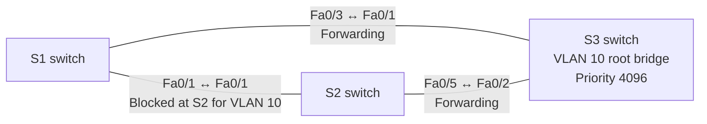

# Lab 02 in Plain Language — Backup Cables Without the Meltdown

## Topology at a glance

**How I'd explain this network (about 20 seconds):** I built a triangle of switches so there was a backup path, then used Spanning Tree to prevent loops. I made S3 the root switch and verified that S2 blocked the redundant VLAN 10 path. I also tested a controlled link shutdown and restoration.

**Reading the diagram:** All three links are physically connected. 'Blocked at S2' means STP stops VLAN 10 forwarding on that port, not that its cable is unplugged. The diagram focuses on the three-switch STP experiment; the Lab 01 router and PCs remained in the project.

**The task.** Connecting switches with spare cables is how you keep an office
network alive when one cable or port fails. But a spare path creates a loop,
and a loop can flood a network into uselessness in seconds. Switches solve
this with a safeguard called Spanning Tree: it elects one switch as the
reference point, maps the cheapest route to it from everywhere, and holds
each spare path in reserve — blocked, but ready. I built that triangle of
switches, watched the safeguard make its choices, then took control of them.

**The setup.** Three Cisco 2960 switches connected in a triangle, carrying
the Sales network from Lab 01, built in Cisco Packet Tracer.

**What I did.**

1. **Read the election.** With all settings equal, the switches picked the one
   with the lowest ID as their reference point, and the safeguard blocked
   exactly one port — the spare path between the other two switches.
2. **Moved the reference point on purpose.** I lowered one switch's priority
   setting, making it the new reference point. The blocked port moved to a
   different link, exactly as the rules predict — traffic patterns changed
   with no cables touched.
3. **Tested a failure.** I shut down one switch-to-switch link. The network
   kept a working route through the third switch. Then I restored the link,
   and the safeguard put the spare path back into reserve.

**The result.** Every stage matched the prediction, confirmed from the
switches' own status reports at each step: who the reference switch was, what
each port's job was, and which path was being held back.

**What broke.** Nothing accidental — the failure in step 3 was a planned
test, and restoring the link was the fix. Two honest limits: I did not
re-run the end-to-end computer tests during the failure step, and I did not
measure how fast the switchover happens. The write-up in this folder says
both, rather than dressing the test up as more than it was.

**What it proves.**

- I understand how redundant networks protect themselves — and how to steer
  that behavior deliberately instead of accepting defaults.
- I can run a controlled failure test: predict the outcome, change one thing,
  and confirm the result from the equipment's own reports.
- I document scope honestly, including what a test did *not* cover.
