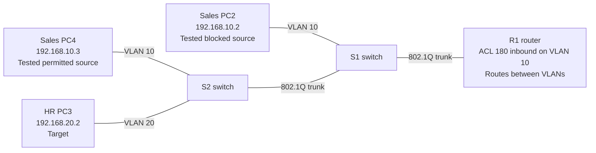

# Lab 03 — Extended ACLs: Selective Inter-VLAN Filtering

**Completed:** October 28, 2026  
**Platform:** Cisco Packet Tracer (Cisco IOS)  
**Lab file:** [Lab 03 Extended ACLs.pkt](./Lab%2003%20Extended%20ACLs.pkt)

## Topology at a glance



**How I'd explain this to a recruiter (about 20 seconds):** I placed a precise traffic-filtering rule on the router. During the test, one Sales PC was blocked from pinging one HR PC, while another Sales PC could still reach it. I verified the permit and deny results and then cleanly removed the ACL assignment.

**Reading the diagram:** This shows the physical VLAN topology and where ACL 180 was applied during the test. It blocked only ICMP from 192.168.10.2 to 192.168.20.2; the ACL assignment was removed at the end of the lab. The intentionally unused PC1 is omitted.

## Objective

Configure a numbered extended access control list (ACL) on a router-on-a-stick topology; deny ICMP from one VLAN 10 host to one VLAN 20 host while allowing other IPv4 traffic; verify interface direction, packet behavior and match counters; then remove the ACL assignment without deleting its definition.

## Topology and addressing

- **R1**: Router-on-a-stick via `GigabitEthernet0/0/0`
- **VLAN 10 gateway**: `GigabitEthernet0/0/0.10` — `192.168.10.1/24`
- **VLAN 20 gateway**: `GigabitEthernet0/0/0.20` — `192.168.20.1/24`
- **PC2 (VLAN 10)**: `192.168.10.2/24` — source host for the deny test
- **PC3 (VLAN 20)**: `192.168.20.2/24` — destination host
- **PC4 (VLAN 10)**: `192.168.10.3/24` — permitted source for comparison
- **PC1**: Intentionally disconnected / unused

## ACL configuration

```cisco
conf t
ip access-list extended 180
 10 deny icmp host 192.168.10.2 host 192.168.20.2
 20 permit ip any any
exit
interface g0/0/0.10
 ip access-group 180 in
end
```

The extended ACL is applied **inbound on the VLAN 10 router subinterface**, close to the source of traffic being filtered.

## Verification and results

### Baseline before ACL enforcement

`PC2> ping 192.168.20.2` — **4/4 replies, 0% loss** after an earlier initial one-packet timeout.

### ACL-enforced tests

| Test | Expected result | Observed |
| --- | --- | --- |
| PC2 → PC3 ICMP | Denied | 0/4 replies, 100% loss, R1 sent destination-unreachable messages |
| PC2 → R1 VLAN 20 gateway (`192.168.20.1`) ICMP | Permitted | 4/4 replies |
| PC4 → PC3 ICMP | Permitted | 4/4 replies |

### ACL match counters

After the PC2 deny test and the two successful four-packet tests, the observed output was:

```text
R1# show ip access-lists 180
Extended IP access list 180
    deny icmp host 192.168.10.2 host 192.168.20.2 (4 match(es))
    permit ip any any (8 match(es))
```

The deny counter remained at four while the permit counter rose from four to eight following the PC4 test. Counter increments support the traffic-test interpretation, but counters alone do not prove end-to-end delivery.

### Interface assignment

```cisco
show ip interface g0/0/0.10
```

Before rollback, the router reported `Inbound access list is 180`.

## Rollback and troubleshooting

The ACL assignment was removed from the VLAN 10 subinterface while preserving the ACL definition:

```cisco
conf t
interface g0/0/0.10
 no ip access-group 180 in
end
show ip interface g0/0/0.10
show ip access-lists 180
```

An initial removal attempt accidentally configured a **named ACL reference called `no`** (`ip access-group no in`). This was corrected by removing that assignment using `no ip access-group no in`. The final verification showed `Inbound access list is not set`, and PC2 → PC3 ping returned to **4/4 successful replies**.

After saving and reopening the Packet Tracer lab, `show ip access-lists 180` still displayed the deny and permit entries. Match counters were no longer displayed after reopening; the ACL definition was preserved.

## CCNA skills demonstrated

- Extended numbered ACL syntax and exact-host matching
- First-match evaluation and explicit permit for remaining IPv4 traffic
- Applying ACLs inbound on 802.1Q router subinterfaces
- Verifying ACL definitions, interface bindings and match counters
- Comparing permitted and denied inter-VLAN traffic
- Troubleshooting negation syntax and safely removing interface assignments
