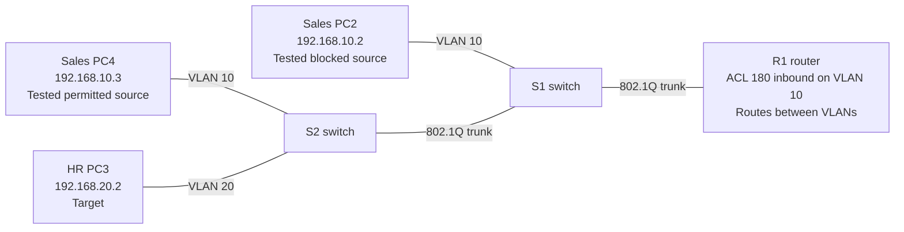

# Lab 03 — Block one ping test while leaving other traffic available

**In one sentence:** I created a targeted router rule that stopped one Sales computer from pinging one HR computer, without blocking the other tested connections.

## Topology at a glance

**How to read it:** The diagram shows where the rule was **applied during testing**. Its interface assignment was removed at the end. This lab tested ICMP (ping), not a complete security policy.

## What I changed

- Created an access control list (ACL): a rule that filters network traffic.
- Applied the rule to incoming Sales traffic on the router.
- Tested blocked traffic, allowed traffic, and the result after removing the rule.

## What I verified

- Blocked Sales PC → HR PC ping: **0 out of 4 replies**.
- Second Sales PC → HR PC ping: **4 out of 4 replies**. The blocked Sales PC could still ping the HR gateway.
- After removing the ACL from the interface, the originally blocked ping succeeded **4 out of 4 times**.

## What went wrong — and how I handled it

During removal, I accidentally created an ACL reference named `no`. I identified it in router output, removed the incorrect assignment, and verified that the intended traffic worked again.

## Why it matters

A narrowly targeted rule can stop one kind of traffic without cutting off every device or service.

## Open the files

- [Technical write-up: configuration, commands, and evidence](./README.md)
- [Open the Packet Tracer project](./Lab%2003%20Extended%20ACLs.pkt)

**Note:** This is a simulated learning project, not a production deployment.
