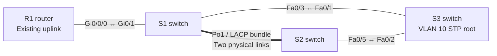

# Lab 04 — Keep a switch connection up when one cable fails

**In one sentence:** I joined two switch cables into one logical connection and confirmed that the connection remained up when one cable was disabled.

## Topology at a glance

**How to read it:** The thick double line between S1 and S2 means **one logical EtherChannel made of two physical cables**. The other lines are independent switch connections. The original PCs are omitted for readability.

## What I changed

- Configured both switch cables as compatible trunks (links that can carry multiple VLANs).
- Used LACP to combine them into one EtherChannel, called Port-channel 1.
- Disabled one member link, restored it, and separately tested how Spanning Tree rerouted after a different link failed.

## What I verified

- Both switches showed **two active bundled members**: their interfaces had `(P)` status.
- When one EtherChannel member was shut down, **Port-channel 1 remained operational** using the other member.
- During the separate Spanning Tree test, the backup path changed from blocked to forwarding; after restoration, the preferred path returned.

## What went wrong — and how I handled it

At first, only one cable had joined the bundle. I added the missing member and verified both were listed. I also waited for Spanning Tree to finish transitioning before accepting the restored port state.

## Why it matters

Combining cables can provide connection redundancy. Spanning Tree separately prevents redundant paths from creating loops.

## Testing limits

The tests verified interface and Spanning Tree states; I did **not** measure throughput or PC-to-PC packet loss during the failure tests.

## Open the files

- [Technical write-up: configuration, commands, and evidence](./README.md)
- [Open the Packet Tracer project](./Lab%2004%20EtherChannel.pkt)

**Note:** This is a simulated learning project, not a production deployment.
