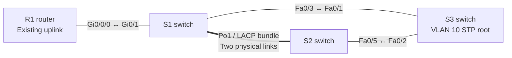

# Lab 04 in Plain Language — Two Cables, One Reliable Connection

## Topology at a glance



**How I'd explain this network (about 20 seconds):** I combined two switch cables into one logical EtherChannel using LACP. I verified that both cables joined the bundle and that it stayed up when one cable was shut down. I also tested how Spanning Tree chose a backup route when a separate switch link failed.

**Reading the diagram:** The double line is ONE logical Port-channel (Po1) made of two physical links: S1 Fa0/1 ↔ S2 Fa0/1 and S1 Fa0/4 ↔ S2 Fa0/6. In the verified normal VLAN 10 STP state, Po1 was alternate/blocked on S2; it became forwarding after S2's direct link to S3 failed. Existing PCs are omitted for readability.

**The task.** I wanted the connection between two switches to survive the loss of one cable. I also wanted the network to avoid loops when there were multiple ways to reach a third switch. I built and tested this in Cisco Packet Tracer while studying for my CCNA.

**The setup.** Three switches form a triangle, so there is a backup path through a third switch (S3). Between S1 and S2, I added a second cable and used **LACP EtherChannel** to make the two cables behave like a single logical connection called **Port-channel 1**.

**What I did.**

1. **Checked the actual wiring.** Used Cisco discovery and interface-status commands to identify the existing links and find safe unused ports.
2. **Matched the switch settings.** Configured the additional ports to operate as the same kind of network trunk as the original connection.
3. **Created the bundle.** Enabled LACP on both switches and verified **two participating interfaces on each side**. Both links belonged to the same operational Port-channel.
4. **Pulled one link out of service.** I intentionally shut down one member. The logical connection stayed operational using the other cable. I restored the cable and verified that both members rejoined.
5. **Tested the backup route.** I separately shut down S2's direct link to the third switch, S3. Spanning Tree Protocol (STP) opened the alternate path through the EtherChannel. After the direct link returned, STP switched back to its preferred route.

**What broke.** My first configuration bundled only **one cable**, even though the logical interface reported itself up. The status output exposed that omission. I configured the missing ports and checked again until both were listed as bundled. Later, I initially checked the restored STP path too soon: the port had been chosen as the root path but was not yet forwarding. Another check confirmed it finished converging.

**Why it matters.** On a real network, a cable failure should not automatically take an entire switch-to-switch connection offline. And a redundant route is only safe when the switches prevent traffic from circulating in a loop. EtherChannel and STP solve different parts of that problem, and I verified both rather than relying on a green link light.

**What it proves.**

- I can build and verify a two-member **LACP EtherChannel** using Cisco IOS.
- I can distinguish an operational logical connection from the state of its individual cables.
- I can explain why an STP-blocked path is not the same thing as a broken EtherChannel.
- I can simulate a fault, inspect evidence, restore the configuration, and verify the final state.

**Quick proof from the lab:**

```text
S1: Po1(SU) LACP Fa0/1(P) Fa0/4(P)
S2: Po1(SU) LACP Fa0/1(P) Fa0/6(P)
```

Those `(P)` flags confirm that **both cables are actually participating**. The full [technical README](./README.md) includes the commands, interface mappings, STP results, and troubleshooting details. The [Packet Tracer file](./Lab%2004%20EtherChannel.pkt) contains the saved network project.

**Limits of the test:** I verified interface/LACP and STP states, not measured link throughput or end-to-end packet loss during the failure tests.
