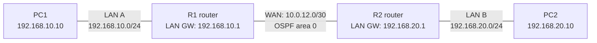

# Lab 05 — Connect two networks and troubleshoot automatic routing

**In one sentence:** I connected two LANs using IPv4 and IPv6 static routes, then enabled OSPF so the routers could learn the IPv4 routes automatically.

## Topology at a glance

**How to read it:** PC1 and PC2 are on different local networks, joined by routers R1 and R2. The middle link is the **WAN connection**, not an EtherChannel. OSPF is used for IPv4 in the final state; IPv6 still uses static routes.

## What I changed

- Assigned addresses to two routers and two PCs, then configured static routes to the opposite LAN.
- Added IPv6 routes and corrected a PC's default gateway (the router address used to reach other networks).
- Enabled OSPF on the routers, advertised both LANs, and investigated why one expected route was initially missing.

## What I verified

- IPv4 routing through OSPF: **PC1 → PC2, 4 out of 4 ping replies**.
- IPv6 using static routes: **PC1 → PC2, 4 out of 4 ping replies**.
- The final routing tables showed OSPF-learned remote LAN routes on **both R1 and R2**.

## What went wrong — and how I handled it

The routers formed an OSPF neighbor connection, but R1 initially lacked the route to R2's LAN. I compared the routing tables and link-state database (the map OSPF builds), removed an unnecessary virtual link, and restarted the WAN interface. The updated information allowed the missing route to appear. The original cause of the stale advertisement wasn't proven.

## Why it matters

Two routers can recognize each other without successfully routing between their LANs. I checked both the network information and the actual end-to-end ping results.

## Testing limits

These are Packet Tracer simulation results; the lab does not measure network performance.

## Open the files

- [Technical write-up: configuration, commands, and evidence](./README.md)
- [Open the Packet Tracer project](./Lab%2005%20Static%20Routing%20and%20OSPF.pkt)

**Note:** This is a simulated learning project, not a production deployment.
