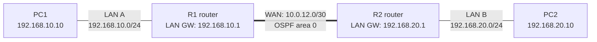

# Lab 05 in Plain Language — Static Routes, OSPF, and Finding a Hidden Routing Problem

## Topology at a glance



**How I'd explain this to a recruiter (about 20 seconds):** I built two LANs connected by two routers. First I set up IPv4 and IPv6 static routes; then I replaced the IPv4 static routes with OSPF. When the routers were neighbors but no route appeared, I investigated the link-state database, corrected the topology advertisement, and verified successful PC-to-PC communication.

**Reading the diagram:** The WAN also uses IPv6 subnet 2001:DB8:12::/64; the LAN IPv6 subnets are 2001:DB8:10::/64 and 2001:DB8:20::/64. OSPFv2 handles IPv4 in the final state; the IPv6 static routes remain separately configured. The double line here emphasizes the WAN link, not an EtherChannel.

**Completed:** November 4, 2026  
**Technical write-up:** [README.md](./README.md)  
**Packet Tracer project:** [Lab 05 Static Routing and OSPF.pkt](./Lab%2005%20Static%20Routing%20and%20OSPF.pkt)

**The task.** I built a small network with two routers and two PCs, with each PC on a different LAN. I first connected the networks using static IPv4 and IPv6 routes. Then I switched the IPv4 side to OSPF so the routers would learn each other's networks automatically.

**What worked.** I configured both routers, verified IPv4 static routes, fixed an IPv6 return route and a misconfigured PC gateway, and got PC1-to-PC2 IPv6 pings working with **4/4 replies**. I then established a FULL OSPF adjacency, advertised both LANs, and made the LAN interfaces passive.

**The challenging part.** When I removed the IPv4 static routes, OSPF neighbors were FULL but R1 still had no route to R2's LAN. I checked OSPF neighbor state, interface participation, process and area information, Router LSAs, Network LSAs, and routing tables. The LSDB showed R2's LAN correctly, but R1's own Router LSA was missing its WAN transit link. I corrected an unnecessary virtual-link configuration and rebuilt R1's OSPF process. A process reset alone did not fix the stale topology information. Reinitializing R1's WAN interface produced updated LSAs and allowed the dynamic route to appear.

**Final proof.**

```text
R1: O 192.168.20.0/24 [110/2] via 10.0.12.2
R2: O 192.168.10.0/24 [110/2] via 10.0.12.1

PC1 -> PC2 (IPv4): 4/4 replies, 0% loss
PC1 -> PC2 (IPv6): 4/4 replies, 0% loss
```

**Why it matters.** A router can have a FULL OSPF adjacency and still fail to install a needed route. Real troubleshooting requires checking not only whether routers are neighbors but also what topology information they advertise and what routes are installed. I also reinforced that the correct static-route destination is the **network prefix**, the next hop must be reachable, and a PC's gateway must be on its local link.

**What I demonstrated:** dual-stack interface addressing, IPv4/IPv6 static routing, OSPFv2 configuration, passive interfaces, administrative-distance reasoning, link-state database analysis, and verified end-to-end connectivity.

**Evidence note:** The technical write-up records command outputs from the lab. The Packet Tracer project file is included in this folder; no separate reopen-and-reverify test is claimed.
