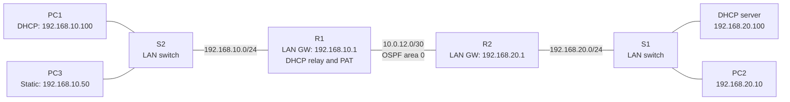

# Lab 06 — DHCP Relay and NAT/PAT

**Completed:** November 6, 2026  
**Platform:** Cisco Packet Tracer / Cisco IOS  
**Project file:** [Lab 06 DHCP Relay and NAT PAT.pkt](./Lab%2006%20DHCP%20Relay%20and%20NAT%20PAT.pkt)  
**Plain-language overview:** [SUMMARY.md](./SUMMARY.md)

## Quick overview

**The problem:** A PC on one network needs an IPv4 address from a DHCP server on another network. Multiple PCs also need to use the same router outside address when reaching an upstream network.

**What I built:** Two routers running OSPFv2, two LANs, a DHCP server on R2's LAN, DHCP relay on R1, and PAT on R1 for two clients.

**Verified result:** After reopening Packet Tracer, PC1 obtained a valid DHCP lease and successfully pinged the remote DHCP server (4/4). In a separate multi-client test, R1 showed ICMP NAT translations for both PC1 and PC3 using the same inside-global address `10.0.12.1`.

[Start with the diagram and simple explanation](./SUMMARY.md).

## Topology at a glance



**How I'd explain this network (about 20 seconds):** I placed a DHCP server on a different subnet from PC1, then configured a router to forward PC1's DHCP requests to that server. I also configured PAT so PC1 and a second PC could share one outside IPv4 address. I proved it by checking the DHCP lease, successful pings and the router's translation table.

## Addressing and roles

| Device | Interface or role | IPv4 | Notes |
| --- | --- | --- | --- |
| R1 | Gi0/0/1, inside LAN | `192.168.10.1/24` | DHCP helper; NAT inside |
| R1 | Gi0/0/0, outside link | `10.0.12.1/30` | NAT outside |
| R2 | Gi0/0/0, link to R1 | `10.0.12.2/30` | OSPF peer |
| R2 | Gi0/0/1, server LAN | `192.168.20.1/24` | Server default gateway |
| DHCP server | Server LAN | `192.168.20.100/24` | Serves PC1's LAN via relay |
| PC1 | Inside client | `192.168.10.101` during first test; `.100` after reopen | DHCP |
| PC3 | Inside client | `192.168.10.50/24` | Static IPv4 |
| PC2 | R2's LAN | `192.168.20.10/24` | Existing client from earlier lab |

R1's IPv6 LAN gateway remained `2001:DB8:10::1/64`. This lab's DHCP and PAT traffic tests were for **IPv4**. IPv6 routing existed from Lab 05 but was not retested end to end for Lab 06.

## Stage 1 — DHCP server and DHCP relay

The DHCP server was configured on the remote `192.168.20.0/24` LAN with a pool for `192.168.10.0/24`:

- Pool name: `LAN10`
- Starting address: `192.168.10.100`
- Maximum users: 50 (addresses `.100` through `.149`)
- Mask: `255.255.255.0`
- Default gateway: `192.168.10.1`
- DNS: `8.8.8.8`

PC1 could not initially obtain the remote DHCP lease. DHCP broadcasts do not ordinarily cross routers, so I added a helper address to R1's interface facing PC1:

```cisco
interface GigabitEthernet0/0/1
 ip address 192.168.10.1 255.255.255.0
 ip helper-address 192.168.20.100
```

**Verified:** PC1 received `192.168.10.101/24` with gateway `192.168.10.1`; after reopening and testing again, it received `192.168.10.100/24`. Both addresses are within the DHCP pool. PC1 pinged `192.168.20.100` with **4/4 successful replies**.

## Stage 2 — Configure PAT on R1

I marked the inside and outside interfaces, selected the permitted inside subnet with a standard ACL, and configured interface overload:

```cisco
interface GigabitEthernet0/0/1
 ip nat inside
!
interface GigabitEthernet0/0/0
 ip nat outside
!
access-list 1 permit 192.168.10.0 0.0.0.255
ip nat inside source list 1 interface GigabitEthernet0/0/0 overload
```

These commands were verified against `show running-config`. The existing R1 DHCP helper, OSPF configuration, IPv4 addresses, and IPv6 addresses were preserved.

**Why PAT:** This translates the inside source addresses of multiple devices to the address on R1's outside interface. Identifiers such as ICMP IDs (and TCP/UDP ports in other traffic) distinguish simultaneous sessions.

**Simulation scope:** `10.0.12.1` is an RFC 1918 private address used on a lab transit network. The test demonstrates how PAT works; it does **not** demonstrate internet access with a publicly routable IP.

## Stage 3 — Validate translation from two clients

PC1 and PC3 both pinged the remote server at `192.168.20.100` successfully. Immediately afterward, R1 displayed these translations (selected rows):

```text
Pro   Inside global    Inside local        Outside local      Outside global
icmp  10.0.12.1:37     192.168.10.101:37   192.168.20.100:37  192.168.20.100:37
icmp  10.0.12.1:5      192.168.10.50:5     192.168.20.100:5   192.168.20.100:5
```

The inside-local addresses are **different**, but both map to **the same inside-global IP** `10.0.12.1`. This is direct evidence that PAT served two clients.

```text
R1# show ip nat statistics
Total translations: 9 (0 static, 9 dynamic, 9 extended)
Hits: 20  Misses: 25
Expired translations: 12
```

Eight of the displayed active translations were ICMP entries for the two clients. Another entry was UDP traffic associated with DHCP. The nine active translations were not nine different PCs. This test verified ICMP PAT for two clients; it did not separately test simultaneous TCP/UDP sessions from both PCs.

## Stage 4 — Save and reopen

The running configurations were saved, and the Packet Tracer project was reopened. Immediately after reopening, R1 reported **0 active translations** but still listed:

```text
Outside Interfaces: GigabitEthernet0/0/0
Inside Interfaces: GigabitEthernet0/0/1
```

Zero translations after restarting the simulation is expected before new traffic.

OSPF first showed a temporary `2WAY/DROTHER` neighbor state during convergence. Without changing the configuration, a later check showed:

```text
192.168.20.1  1  FULL/DR  00:00:35  10.0.12.2  GigabitEthernet0/0/0
```

R1 also had the expected OSPF-learned remote LAN route:

```text
O 192.168.20.0 [110/2] via 10.0.12.2, GigabitEthernet0/0/0
```

Final PC1 verification after reopening:

```text
IPv4 Address:    192.168.10.100
Subnet Mask:     255.255.255.0
Default Gateway: 192.168.10.1

C:\>ping 192.168.20.100
Packets: Sent = 4, Received = 4, Lost = 0 (0% loss)
```

## Troubleshooting and learning

1. **DHCP did not work before relay:** R1 needed `ip helper-address` on the interface facing the DHCP client.
2. **CLI recall gap:** I initially configured NAT inside/outside correctly but struggled to recall `access-list` and `ip nat inside source list ... overload`. I practiced both commands until I could recall them correctly, then verified the resulting configuration.
3. **OSPF looked incomplete on reopen:** I waited for the adjacency to converge rather than changing a working configuration. I also checked that the actual OSPF route was installed, not just that the neighbor was FULL.

## CCNA skills demonstrated

- DHCP pools, DORA flow context, and router DHCP relay
- Cisco IOS `ip helper-address` configuration
- Standard ACL and wildcard-mask usage to identify NAT-eligible source addresses
- Interface-based PAT (`overload`) and inside/outside NAT boundaries
- Reading `show ip nat translations` and `show ip nat statistics`
- Distinguishing translation entries from unique clients
- Verifying DHCP, end-to-end routing, and OSPF after a saved-project reopen
- Recording real results and test limitations

## Evidence and project-file status

The verification evidence comes from CLI and PC outputs captured during the guided lab. The supplied Packet Tracer project is a proprietary binary and was not independently parsed to inspect every stored device configuration. The **[Lab 06 Packet Tracer project](./Lab%2006%20DHCP%20Relay%20and%20NAT%20PAT.pkt)** is included in this directory and can be opened in Packet Tracer.

This is a self-directed training simulation, not a production deployment.
