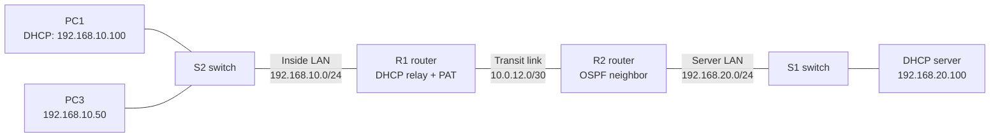

# Lab 06 — Give PCs addresses and let them share one router address

**In one sentence:** I made a computer get its IPv4 address from a server on a different network, then demonstrated two computers sharing one router outside IPv4 address using PAT.

## Topology at a glance

## The problem

A computer usually sends a local broadcast when it needs an IPv4 address. A router normally does not pass that broadcast to another network, so PC1 could not directly reach a DHCP server on the opposite LAN.

Separately, several PCs may need to communicate through one upstream-facing router address.

## What I changed

- Put the DHCP server at `192.168.20.100` and configured a pool for the other network.
- Configured R1 to forward DHCP requests to that server.
- Configured PAT on R1 so PC1 and PC3 could share the outside address `10.0.12.1`.

## What I verified

- After reopening the saved Packet Tracer project, PC1 received `192.168.10.100` via DHCP with gateway `192.168.10.1`.
- PC1 pinged the remote server: **4/4 replies, 0% loss**.
- R1 showed OSPF neighbor **FULL/DR** and the remote network route `192.168.20.0/24`.
- R1's translation table displayed **both PC1 (`192.168.10.101`) and PC3 (`192.168.10.50`) mapped to `10.0.12.1`** during the earlier two-client PAT test.

## What went wrong — and what I learned

PC1 could not obtain a remote DHCP lease until I added a router helper address. I also had to practice the exact Cisco commands for the NAT ACL and PAT overload rule. When OSPF initially showed a partial neighbor state after reopening, I checked again and confirmed it reached FULL and learned the remote route.

## Why it matters

DHCP relay lets a central server provide addresses across routed networks. PAT lets multiple inside devices use one outside IPv4 address. I checked both with actual device output instead of assuming the configuration was enough.

## Testing limits

This uses Packet Tracer and a **private** outside IPv4 address for demonstration. It does not test public internet access. The two-client PAT evidence is from ICMP traffic, not separate TCP/UDP application tests.

## Open the files

- [Technical write-up: commands and verification](./README.md)
- **Packet Tracer file:** `Lab 06 DHCP Relay and NAT PAT.pkt` — to be added to this folder

These are self-directed Cisco learning exercises, not a production network.
