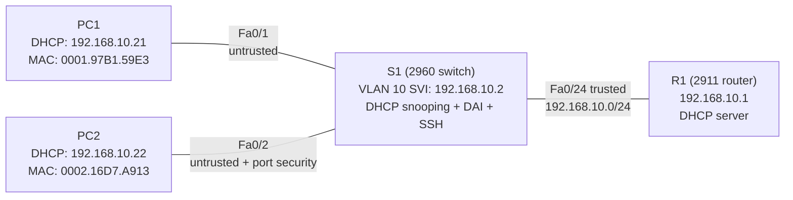

# Lab 07 — Switch Security and SSH

**Completed:** November 9, 2026  
**Platform:** Cisco Packet Tracer / Cisco IOS  
**Project file:** `Lab 07 Switch Security and SSH.pkt` — saved locally; GitHub upload pending  
**Plain-language summary:** [SUMMARY.md](./SUMMARY.md)

## Quick overview

**The problem:** A small LAN needs automatic addressing, protection against unauthorized DHCP servers and suspicious ARP traffic, limits on devices connected to a particular switch port, and secure remote switch management.

**What I built:** A router-based DHCP server, a managed VLAN 10 switch, two DHCP clients, port security with sticky MAC learning, DHCP snooping, Dynamic ARP Inspection (DAI), and SSH-only management.

**Verified result:** Both PCs received DHCP leases and appeared in S1's DHCP snooping binding table. DAI permitted a legitimate ARP packet. SSH login from PC1 succeeded with privilege level 15, while Telnet did not provide an interactive login. A deliberately unauthorized MAC on Fa0/2 caused an error-disabled shutdown; the interface was recovered and the original PC regained connectivity.

[Start with the diagram and simple explanation](./SUMMARY.md).

## Topology at a glance



All three connected S1 ports are access ports in VLAN 10. The router-facing port is trusted for DHCP snooping and DAI; the PC-facing ports remain untrusted.

**How I'd explain this network (about 20 seconds):** I built a small LAN that hands out IP addresses automatically and uses multiple switch-security features to protect access. I verified genuine DHCP clients and ARP traffic, configured SSH-only management, then deliberately connected the wrong PC to a secured switch port. The port shut down as intended, and I diagnosed and recovered it.

## Addressing and topology

| Device | Connected interface / role | Address or identifier | Notes |
| --- | --- | --- | --- |
| R1 | Gi0/0, LAN and DHCP server | `192.168.10.1/24` | Default gateway |
| S1 | VLAN 10 management SVI | `192.168.10.2/24` | Default gateway `192.168.10.1` |
| S1 | Fa0/24 → R1 | Access VLAN 10 | Trusted for DHCP snooping and DAI |
| S1 | Fa0/1 → PC1 | Access VLAN 10 | Untrusted |
| S1 | Fa0/2 → PC2 | Access VLAN 10 | Untrusted; one sticky secure MAC |
| PC1 | DHCP client | `192.168.10.21` | MAC `0001.97B1.59E3` |
| PC2 | DHCP client | `192.168.10.22` | MAC `0002.16D7.A913` |

## Stage 1 — Management SVI and router DHCP

S1's VLAN 10 interface was configured for remote management:

```cisco
vlan 10
!
interface Vlan10
 ip address 192.168.10.2 255.255.255.0
 no shutdown
!
ip default-gateway 192.168.10.1
```

`show ip interface brief` reported **Vlan10 up/up**. From S1, `ping 192.168.10.1` succeeded **5/5**.

R1 served addresses locally rather than using a separate DHCP server:

```cisco
ip dhcp excluded-address 192.168.10.1 192.168.10.20
ip dhcp pool LAN10
 network 192.168.10.0 255.255.255.0
 default-router 192.168.10.1
 dns-server 8.8.8.8
```

The excluded-address statement was verified in R1's running configuration. R1's DHCP binding table showed two automatic leases:

```text
192.168.10.21  0001.97B1.59E3  Automatic
192.168.10.22  0002.16D7.A913  Automatic
```

PC1 and PC2 each successfully pinged `192.168.10.1`, **4/4 replies, 0% loss**.

## Stage 2 — Port security on PC2's switch port

Fa0/2 was configured as an access port with one authorized sticky MAC address and shutdown behavior on violation.

```cisco
interface FastEthernet0/2
 switchport mode access
 switchport access vlan 10
 switchport port-security
 switchport port-security maximum 1
 switchport port-security mac-address sticky
 switchport port-security violation shutdown
```

**Initial problem:** The maximum, sticky-learning and shutdown settings were present, but the command `switchport port-security` had been omitted. PC2 could still ping the router, yet `show port-security interface fa0/2` reported `Port Security: Disabled`. The missing enable command was added and the feature was verified again.

**After correction:**

```text
Port Security              : Enabled
Port Status                : Secure-up
Violation Mode             : Shutdown
Maximum MAC Addresses      : 1
Sticky MAC Addresses       : 1
Last Source Address:Vlan   : 0002.16D7.A913:10
Security Violation Count   : 0
```

The secure-address table identified `0002.16D7.A913` as `SecureSticky` on Fa0/2, VLAN 10.

## Stage 3 — DHCP snooping

DHCP snooping was enabled globally and for VLAN 10. The router-facing Fa0/24 port was trusted, while Fa0/1 and Fa0/2 were left untrusted.

```cisco
ip dhcp snooping
ip dhcp snooping vlan 10
no ip dhcp snooping information option
!
interface FastEthernet0/24
 ip dhcp snooping trust
```

**Troubleshooting:** PC1's first DHCP request after enabling snooping failed. S1 showed that DHCP Option 82 insertion was enabled. After disabling insertion with `no ip dhcp snooping information option`, PC1 obtained a lease and a binding appeared. This is an observed fix in Packet Tracer; the precise packet-level cause was not independently established.

After renewing both PCs, S1 showed:

```text
MacAddress          IpAddress        Lease(sec)  Type           VLAN  Interface
00:01:97:B1:59:E3   192.168.10.21    86400       dhcp-snooping  10    FastEthernet0/1
00:02:16:D7:A9:13   192.168.10.22    86400       dhcp-snooping  10    FastEthernet0/2
Total number of bindings: 2
```

PC1 then pinged R1 successfully (**4/4**). PC2's port security remained `Enabled`, `Secure-up`, and associated with one sticky MAC.

## Stage 4 — Dynamic ARP Inspection (DAI)

DAI was activated for VLAN 10, with Fa0/24 trusted. PC-facing ports stayed untrusted.

```cisco
ip arp inspection vlan 10
!
interface FastEthernet0/24
 ip arp inspection trust
```

`show ip arp inspection vlan 10` reported **Configuration: Enabled; Operation: Active**. The interface summary showed Fa0/1 and Fa0/2 untrusted, and Fa0/24 trusted.

PC1 successfully pinged PC2 at `192.168.10.22` (**4/4**). The DAI statistics changed from zero to:

```text
VLAN 10: Forwarded 1, Dropped 0, DHCP Drops 0, ACL Drops 0
VLAN 10: DHCP Permits 1, ACL Permits 0
Source MAC Failures 0, Dest MAC Failures 0, IP Validation Failures 0
```

**Scope:** This confirms that at least one legitimate ARP packet was permitted using a DHCP binding. A forged ARP packet was **not** injected or shown to be rejected, so the lab does not claim a malicious-ARP blocking test.

## Stage 5 — SSH-only switch management

The switch used its VLAN 10 management address for SSH access.

Representative IOS configuration:

```cisco
hostname S1
ip domain-name ccnalab.local
! RSA key pair generated with a 2048-bit modulus
ip ssh version 2
username admin privilege 15 secret <LAB_PASSWORD>
!
line vty 0 4
 login local
 transport input ssh
line vty 5 15
 login local
 transport input ssh
```

The actual lab password is intentionally not included here. The initial `show running-config | include username` display omitted `privilege 15` even after the account was recreated. Actual remote verification resolved the question: PC1 connected using `ssh -l admin 192.168.10.2`, reached an `S1#` prompt, and `show privilege` returned **Current privilege level is 15**, without using `enable`.

`show ip ssh` reported:

```text
SSH Enabled - version 2.0
Authentication timeout: 120 secs; Authentication retries: 3
```

A Telnet attempt from PC1 produced:

```text
Trying 192.168.10.2 ...Open
[Connection to 192.168.10.2 closed by foreign host]
```

The TCP connection opened briefly, but S1 immediately closed it without allowing a Telnet login. This matches the verified SSH-only VTY configuration.

## Stage 6 — Intentional port-security violation and recovery

I tested the switch's response to an unauthorized client, then recovered the port without relaxing the security policy.

**Baseline:** Fa0/2 permitted only PC2's sticky MAC `0002.16D7.A913`, with a maximum of one and violation mode `shutdown`.

**Controlled failure:** After saving a backup, I temporarily moved PC1 (MAC `0001.97B1.59E3`) from Fa0/1 to Fa0/2 and attempted to ping R1.

```text
PC1 → 192.168.10.1: Sent 4, Received 0, Lost 4 (100% loss)

Port Security              : Enabled
Port Status                : Secure-shutdown
Violation Mode             : Shutdown
Last Source Address:Vlan   : 0001.97B1.59E3:10
Security Violation Count   : 1

Fa0/2 interface status: err-disabled
```

**Diagnosis:** Layer 2 port-security enforcement—not a DHCP or routing failure. The unauthorized source MAC exceeded the port's single secure-MAC policy and triggered shutdown.

**Recovery:** I restored PC1 to Fa0/1 and PC2 to Fa0/2, then reset the disabled port:

```cisco
interface FastEthernet0/2
 shutdown
 no shutdown
```

Subsequent checks reported `connected`, `Secure-up`, sticky MAC count `1`, and the original PC2 MAC. The violation counter returned to zero in this Packet Tracer recovery. Finally, PC2 pinged R1 **4/4 successfully, 0% loss**.

The full workflow followed **Observation → Analysis → Verification → Resolution**.

## CCNA skills demonstrated

- Configuring a VLAN management SVI and switch default gateway
- Serving and verifying DHCP leases on a router
- Configuring sticky MAC port security and shutdown violation mode
- Differentiating working connectivity from actual security enforcement
- Trust boundaries for DHCP snooping and Dynamic ARP Inspection
- Investigating a DHCP Option 82 compatibility issue
- Reading DHCP snooping bindings and DAI counters
- Generating RSA keys, enforcing SSHv2 and local VTY authentication
- Verifying SSH privileges and preventing Telnet access
- Diagnosing `err-disabled` ports and restoring access without weakening security

## Saved configuration and project-file status

Both S1 and R1 were saved successfully with `copy running-config startup-config`; each returned `[OK]`. The Packet Tracer project was saved locally as `Lab 07 Switch Security and SSH.pkt`.

**GitHub upload still pending:** The `.pkt` file has not yet been added to this directory. The results above are based on actual CLI and PC outputs from the lab session; the saved binary has not been independently opened or reverified.

This is a self-directed Cisco learning simulation, not a production deployment.
