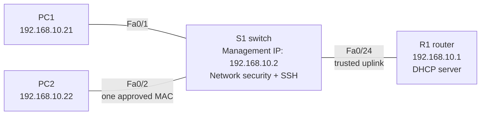

# Lab 07 — Protect a small network and manage its switch securely

**In one sentence:** I configured a small network to assign IP addresses automatically, check trusted network traffic, restrict a switch port to one device, and allow remote administration through SSH instead of Telnet.

## Topology at a glance

All devices are on VLAN 10 (`192.168.10.0/24`).

## The problem

A working network isn't necessarily a protected network. An unauthorized device could appear on a switch port, a rogue DHCP server could send address information, or remote management might use an insecure protocol.

## What I changed

- Configured R1 to hand out IP addresses to the two PCs.
- Gave S1 a management address of `192.168.10.2`.
- Limited S1's PC2 port to one learned, approved MAC address.
- Enabled DHCP snooping so only the router-facing port is trusted to send DHCP server responses.
- Enabled Dynamic ARP Inspection (DAI) to check ARP messages from untrusted ports against learned DHCP bindings.
- Configured SSH version 2 for remote management and restricted VTY lines to SSH rather than Telnet.

## What I verified

- PC1 received `192.168.10.21`; PC2 received `192.168.10.22`.
- S1's DHCP snooping table showed **both clients** and their correct switch ports.
- PC1 successfully pinged PC2: **4/4 replies, 0% loss**.
- DAI reported **1 legitimate ARP packet forwarded, 1 DHCP-based permit, and 0 drops**.
- PC1 successfully logged into S1 through SSH and confirmed **privilege level 15**.
- A Telnet connection was closed without providing an interactive login.
- After intentionally connecting the wrong PC to the secured port, Fa0/2 entered `err-disabled` with **1 port-security violation**, and the ping failed **4/4**.
- After restoring the original PC and resetting the interface, Fa0/2 was `Secure-up`; PC2 pinged R1 successfully **4/4**.

## What went wrong — and what I learned

**Port security wasn't actually enabled at first.** The switch showed the correct-looking security settings, and PC2 could ping normally, but the `show port-security` output reported `Disabled`. Adding the missing enable command fixed it. Successful connectivity alone is not proof that a security feature is active.

**PC1's DHCP request failed after I enabled DHCP snooping.** The switch was inserting DHCP Option 82 information. I disabled that insertion, retried DHCP, and verified both leases in the switch's binding table.

**The deliberate attack test disabled Fa0/2.** I used the violation counter, last source MAC, and interface state to identify the issue before restoring the original cable and recovering the interface.

## Why it matters

Switch security is about defining which ports and devices to trust, then checking that the rules actually work. This lab combined normal operation, a controlled failure, evidence-based troubleshooting, and recovery.

## Testing limits

The DAI test **proved one legitimate ARP packet was permitted**. It did **not** include a forged ARP packet, so I am not claiming that I observed DAI block an actual ARP-spoofing attempt. The deliberately triggered and observed attack-like condition was a **port-security MAC violation**.

The Packet Tracer project is saved locally and uploaded to this GitHub folder. The file was not independently reopened for another validation run.

## Open the files

- [Technical write-up: commands, device output, and troubleshooting](./README.md)
- [Open the saved Packet Tracer project](./Lab%2007%20Switch%20Security%20and%20SSH.pkt)

This is a self-directed training simulation, not a production network.
