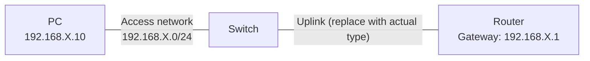

# Lab NN — <Title>

**Date:** YYYY-MM-DD
**Tool:** Cisco Packet Tracer
**Topics:** <e.g. VLANs, trunking, inter-VLAN routing>

## 1. Objective

<One or two sentences: what is this lab proving I can do?>

## Topology at a glance — REQUIRED FOR EVERY LAB

Create a **GitHub-rendered Mermaid diagram** based on the actual verified Packet Tracer wiring, not a hypothetical design. Use clear device labels, subnet or VLAN labels, and no more detail than a recruiter needs.



**How I'd explain this to a recruiter (about 20 seconds):** [One plain-language statement of the business problem, what I configured, and how I proved it worked.]

**Reading the diagram:** [Define the line meanings, ports/VLANs/subnets and any intentionally omitted devices; note when the diagram depicts a particular STP or ACL test state.]

**Before publishing:** Replace ALL placeholders; match the `.pkt` and the `show` outputs; don't claim ping/failover evidence that wasn't collected. Also put this same diagram and pitch near the top of `SUMMARY.md`.

## 2. Topology

<Devices, how they're connected, IP addressing plan. Paste a simple diagram or describe it.>

```
Example:

        [Router R1]----trunk----[Switch SW1]----[PC1 (VLAN 10)]
                                   |
                                   +----[PC2 (VLAN 20)]
```

| Device | Interface | IP / VLAN |
|--------|-----------|-----------|
|        |           |           |

## 3. Configuration

<The actual commands run on each device, in order. Paste from the session, don't retype from memory.>

### Device 1

```
!
! paste running-config excerpts or the exact commands entered
!
```

## 4. What broke

<Describe the fault in your own words. What did you expect, and what actually happened?>

## 5. What fixed it

<The troubleshooting steps, in the order you took them. Which show/debug commands pointed at the cause?>

1.
2.
3.

## 6. Verification

<Proof it works — ping output, show command results.>

```
<paste output>
```

## 7. Takeaway

<The one thing you'll remember under exam pressure.>
