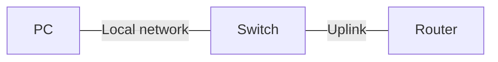

# Lab NN — [Plain-language title]

**Completed:** YYYY-MM-DD  
**Tool:** Cisco Packet Tracer  
**Packet Tracer file:** [Actual filename.pkt](./Actual%20filename.pkt)  
**Simple explanation:** [SUMMARY.md](./SUMMARY.md)

## Quick overview

**The problem:** [One plain sentence describing what needed to work.]

**My solution:** [What I built or configured, explained without unexplained acronyms.]

**Proof:** [Exact result from the test: ping count, route, interface status, etc.]

## Topology at a glance

Create a GitHub-rendered Mermaid diagram using the **verified project wiring**. Label each device, important subnet/VLAN, and any blocked, redundant, or special link. Keep labels short.

**Reading the diagram:** [What the lines/labels mean. State what was intentionally omitted.]

## What I configured

[Exact, verified Cisco IOS commands and device/interface assignments. Do not invent configuration.]

## What went wrong (if anything)

[Observed failure and its evidence. Say "No unexpected failure" when appropriate.]

## How I checked and fixed it

[Diagnostics, correction, and commands that prove the end state.]

## Results and limits

[Quote only tests actually completed. State important untested conditions.]

## What I learned

[One or two sentences with the main lesson.]

---

### Make SUMMARY.md easy to scan

Create a matching **SUMMARY.md** with these sections, in this order:

1. **In one sentence** — the purpose and outcome.
2. **Topology at a glance** — the same verified Mermaid diagram.
3. **What I changed** — two or three short, plain-language steps.
4. **What I verified** — actual results and any testing limits.
5. **What went wrong and how I fixed it** — brief and factual.
6. **Open the files** — link to the technical README and the real `.pkt` file.

Explain any networking acronym the first time you use it. Avoid generic claims like "improved performance" without measurements. Keep the technical details in README.md and the quick explanation in SUMMARY.md.

**Before publishing:** Replace placeholders, match the saved project and command outputs, verify every link, and do not imply a test passed if it was not performed.
